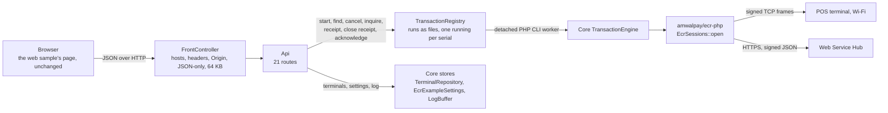

# Implementation guide - the PHP web sample

For a PHP developer putting a POS-terminal payment flow behind a web application, and for a
maintainer. It explains how the PHP sample reproduces the ASP.NET Core web sample of
[AmwalpayEcrWindowsExample](https://github.com/amwal-pay/AmwalpayEcrWindowsExample) and where PHP
forced a different shape. The rules themselves are the samples' own; read their
`AmwalECR-Web-Example/docs/implementation.md` for the reasoning behind each one.

## 1. What is the same, and where it lives

| Web sample (C#) | PHP sample | Notes |
|---|---|---|
| `wwwroot/` | `web/public/` | Copied file for file. Three sentences changed: the key-storage caption, the fake-terminal name, a comment about the 160 s Web Service wait. |
| `Api/*.cs`, `Dtos.cs` | `src/Web/Api.php`, `src/Web/Views.php` | Same routes, shapes, status codes and messages. |
| `Hosting/SecurityMiddleware.cs`, `Program.cs` | `src/Web/FrontController.php` | Same headers, CSP, guard, 64 KB cap, JSON 404, "Unexpected error". |
| `Services/TransactionRegistry.cs` | `src/Web/TransactionRegistry.php` | Same state machine and API; files and worker processes instead of memory and `Task.Run` (section 2). |
| Core `TransactionEngine`, `TransactionOutcomes`, `ResultPresenter` | `src/Core/` | Same flow, same classification, same wording. |
| Core `TransactionFormState`, `AmountEntry`, `AmountLimits` | `src/Core/TransactionFormState.php`, `AmountEntry.php` | Same fields, bounds and messages. Amounts stay exact decimal text. |
| Core `TerminalRepository`, `Terminal`, `TerminalValidator`, `EcrModes` | `src/Core/` | Same `terminals.json`, same messages. |
| Core `EcrExampleSettings`, `ISecretProtector`, `SelectedTerminalConfig`, `LogBuffer` | `src/Core/` | Keys encrypted with AES-256-GCM under a key file in `keys/` (Data Protection's role). The log is a shared file of 500 lines. |
| `QRCoder` | `bacon/bacon-qr-code` | SVG, error-correction level M. |

## 2. Transactions run on the server, in PHP

A card payment takes as long as the cardholder does, and PHP ends a request when the response is
sent. So, as in the web sample, `POST /api/transactions` only **starts** a run and returns `202`; the
page polls `GET /api/transactions/{id}` every 500 ms.

- **Where a run executes.** `Spawner` starts `web/bin/worker.php <data> <run> <generation> run` as a
  detached PHP CLI process (`start /B` on Windows, `&` elsewhere). The worker has no time limit and
  ignores client aborts. Nothing in it depends on the HTTP request.
- **Where a run lives.** `runs/<id>.run`: the request, the state (serialised, restricted to the
  known classes on read), version, generation, timeout and timestamps. Every read-modify-write holds
  one registry lock (`runs/.registry.lock`), the counterpart of `lock (_gate)`.
- **Single flight per terminal.** `start()` and `inquire()` check for a busy run on the serial
  inside the lock: `409` with the running id. The SDK's own terminal lock enforces the same a level
  lower, across every process on the machine.
- **The reference is durable before anything is sent.** For a sale, void or refund with a blank
  reference the registry makes one and stores it with the run, then starts the worker. The web
  sample's guide lists this as the fix for its own in-memory design (its section 11.4, item 2).
- **Cancel.** In the lock: `checking` becomes `idle` (the worker asks, in the same lock, before it
  sends, and is told no); `inProgress` becomes `failed` with the reference and the "You stopped
  waiting" message for a sale, void or refund, `idle` for an inquiry. The worker's late answer is
  discarded because the run is no longer busy (the SDK journal still records what really happened).
- **Generations.** Each start of work on a run (the first attempt, an inquiry follow-up, a receipt
  fetch) bumps `generation`. A worker writes only if its generation is still current, the PHP
  counterpart of a run's `CancellationTokenSource`.
- **A worker that dies.** A worker holds `runs/<id>.<generation>.worker` locked for its whole life.
  A run that is still waiting 15 s after its worker was started, with that lock free, belongs to a
  dead worker. It becomes `failed` with its reference ("stopped unexpectedly on the server... may
  still complete"), never "not done" and never a spinner. The web sample keeps runs in memory and
  lists losing them as a known limitation.
- **Retention, acknowledge, reload.** As in the web sample: 12 h for finished runs nobody read,
  `DELETE` acknowledges (`409` while busy), and `GET /api/transactions` lets a reloaded page adopt
  the newest run.

State model, polling contract and the meaning of every field are exactly those of the web sample's
guide (sections 4 and 5).

## 3. Settings at rest

`settings.dat` is `AEX1 | iv | tag | AES-256-GCM(json)` under a random 256-bit key in
`keys/settings.key`. As with Data Protection's key ring, **the key file is not itself encrypted**:
what protects it is the data folder's permissions (NTFS ACLs on Windows; `0700`/`0600` elsewhere).
A lost or mismatched key file resets the settings to SIT with no keys and shows a notice until a key
is saved. Keys are write-only through the API.

## 4. Logging

The SDK logs through `EcrLogger::from()` into `LogBuffer` with the tag `Ecr` or `EcrWebService`,
stamped `HH:mm:ss.fff`, one shared file for the web requests and the workers, capped at 500 lines.
Every line has already passed the SDK's redactor: masked PANs appear, a key never does.

## 5. Tests

`tests/Example/` in the SDK repository hosts this app for real and pins what the web sample's
`TerminalTests`, `SettingsTests`, `ConfigCardTests`, `MetaTests`, `FormValidationTests`,
`TransactionLifecycleTests`, `ReceiptTests`, `QrTests`, `LogTests` and `SecurityTests` pin, plus the
dead-worker and retention cases. They run against the SDK source (the example's own install uses the
artifact).

## 6. Extending

- **A rule** (validation, wording, outcome) belongs in `src/Core`, as in the Windows samples.
- **HTTP or process lifetime** belongs in `src/Web`.
- **Several servers**: replace the file registry with one over a database (atomic single flight per
  serial, durable reference before sending, result and release together, orphans become failures
  with their reference), and give the SDK a shared `TransactionJournal` and `TerminalLock` through
  `EcrSessions::open(..., guard: ...)`.
- **Authentication**: put it in `FrontController` before `Api`, on every route, and keep the guard.
